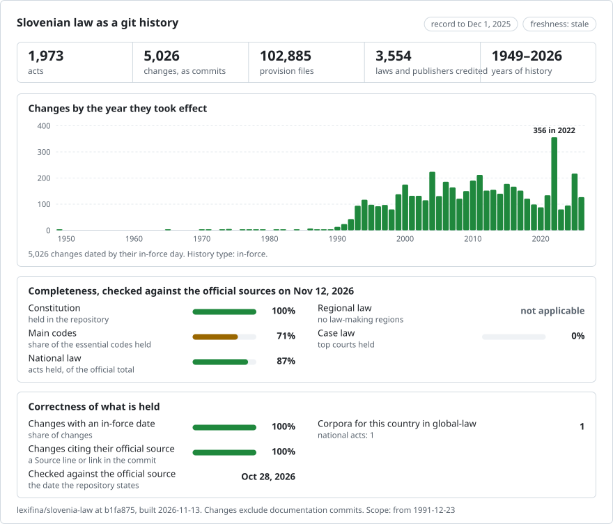

# Slovenian law, change by change

[Slovenščina](README.md) · **English**

<picture>
<source media="(prefers-color-scheme: dark)" srcset="data/effort-dark.svg">

</picture>

Part of [lexifina/global-law](https://github.com/lexifina/global-law), one git history for every country's law: this is Slovenia's national law, which global-law reads at `slovenia/national/acts/`.

Two acts of the Republic of Slovenia as a git repository: the Constitution (Ustava Republike Slovenije, URS,
Uradni list RS, št. 33/91-I) and the National Assembly Elections Act (Zakon o volitvah v državni zbor, ZVDZ,
Uradni list RS, št. 44/92). Each amending act is one commit, credited to that act and dated the day it took effect, at
noon in Ljubljana. The text is the text as enacted and every unofficial consolidated text (neuradno prečiščeno
besedilo, NPB) published by the Government Office for Legislation in [PIS](https://pisrs.si).

## Questions as git commands

| Question | Command |
| --- | --- |
| What did Article 68 of the Constitution say on 13 July 1997? | `python tools/na_dan.py 1997-07-13 urs 68` |
| ... and the next day, when UZS68 took effect? | `python tools/na_dan.py 1997-07-14 urs 68` |
| The whole Constitution as it stood on 1 January 2000 | `python tools/na_dan.py 2000-01-01 urs` |
| Which act wrote each paragraph of Article 68? | `git blame urs/clen-068.md` |
| Every change to Article 68, with the act and the day | `git log --follow --format="%ad %an" --date=short urs/clen-068.md` |
| The same, with the words | `git log -p --word-diff urs/clen-068.md` |
| Everything one amending act changed | `git show akt/2003-01-0899` |
| What changed in the ZVDZ on one day | `git show zvdz/2006-08-09 --stat` |
| The commit in force at the end of a day (UTC) | `git rev-list -1 --before="2004-06-15T23:59:59Z" main -- urs` |
| All amending acts with their dates | [`akti.csv`](akti.csv) |
| Changes no amending act explains | `git log --author="PIS RS" --format="%ad %s" --date=short` |
| Changes made by Constitutional Court decisions | `git log --author="odl. US" --format="%ad %an %s" --date=short` |

Article files are `clen-NNN.md` (`clen-003a.md` is Article 3.a). In PowerShell, quote a revision with a path:

**Or ask in plain words.** The same record is free to use without git, an account or a key:

- **[Ask Claude about Slovenian law](https://global-law.lexifina.com/v1/try_claude?country=slovenia&q=what%20does%20the%20Constitution%20%28Ustava%20Republike%20Slovenije%29%20say%20about%20freedom%20of%20work%20%2849.%20%C4%8Dlen%29%20today%2C%20and%20which%20constitutional%20acts%20have%20changed%20the%20Constitution%20since%201991%3F%20Quote%20the%20words%20of%20the%20law%2C%20name%20the%20law%20behind%20each%20change%20with%20the%20day%20it%20took%20effect%2C%20and%20cite%20the%20official%20publisher%27s%20page.)**: one click opens Claude with a first question ready (freedom of work in the Constitution, and how the Constitution has changed).
- **[Ask ChatGPT](https://global-law.lexifina.com/v1/try_chatgpt?country=slovenia&q=what%20does%20the%20Constitution%20%28Ustava%20Republike%20Slovenije%29%20say%20about%20freedom%20of%20work%20%2849.%20%C4%8Dlen%29%20today%2C%20and%20which%20constitutional%20acts%20have%20changed%20the%20Constitution%20since%201991%3F%20Quote%20the%20words%20of%20the%20law%2C%20name%20the%20law%20behind%20each%20change%20with%20the%20day%20it%20took%20effect%2C%20and%20cite%20the%20official%20publisher%27s%20page.)**: the same question in ChatGPT.
- **[Call the API in your browser](https://global-law.lexifina.com/v1/search_law?query=letni+dopust&jurisdictions=slovenia)**: Slovenian law searched for "letni dopust", answered as JSON. No key for 5 calls a minute; [every tool](https://global-law.lexifina.com/v1), [keys and documentation](https://lexifina.com/api).

The assistants read it through the free Global law connector (MCP, `https://global-law.lexifina.com/mcp`); the first time, the chat gives the link that adds it. In Claude, choose "Always allow" so that each look-up is not asked about. Ask in Slovenian or in English.
`$r = git rev-list -1 --before="2004-06-15T23:59:59Z" main -- urs; git show "$($r):urs/clen-014.md"`.
After a rebuild of this repository, update an existing clone with `git fetch --force --tags`.

## The dates, and which one we use

A Slovenian act has a day it was adopted (`Adopted:`, sprejeto), the day the Uradni list published it (`Published:`,
objavljeno) and the day it took effect (`In-force:`, velja od). **Commits are dated the day the change took effect**, at
noon in Ljubljana: that is the day that decides which text applies. It is the day PIS's register of acts gives as the
start of validity (veljaOd) of the act that produced the version. Where an act applies from a later day than it took
effect, the commit also has `Applies-from:`. All dates are in every commit message.

Constitutional acts take effect when the National Assembly proclaims them, a few days before the Uradni list prints
them; those commits say so in a `Date-note:` trailer. Two Constitutional Court decisions and the official
consolidated text of 2006 have no in-force day in the register; they are dated by publication, with a `Date-note:`.
No change here is before 1970, so no date is clamped.

## How it is checked

`tools/check_repo.py` reads every version of both acts back from git on the day it took effect and compares it with
PIS: file by file with the text parsed from PIS's data, and word for word with all the words PIS gives for that
version, read independently of the parser. `tools/test_repo.py` runs the commands in this README and checks blame,
the on-date reader, the order of `git log --follow`, the tags, the trailers and the authors. The results are in
[`REPRODUCE.md`](REPRODUCE.md).

## What "author" means

The author of a commit is the act that made the change: `Uradni list RS, št. 42/97 (UZS68)`, with an address ending
`@pisrs.invalid`, which cannot exist, so `git blame` names the act. PIS's register names, for each consolidated text,
the one act whose entry into force produced it. A changed article is credited to that act only when the act's own
text names the article ("se 68. člen spremeni tako, da glasi"), makes a replacement in the whole text that explains the
change ("v celotnem besedilu zakona se besedilo ... nadomesti"), or (for UZ148, whose text PIS does not hold) its title
names it. The final provisions of an amending act, which PIS prints after the act, are credited to that act.

A change none of these explains is committed separately by `PIS RS (neuradno prečiščeno besedilo)`, with "sprememba
brez pojasnila" in its subject; it is never credited to an act. These are PIS's own editing: the move from the text as
printed in 1991 and 1992 to the consolidated form (the preamble and signatures left out, corrected misprints, the
final provisions moved after the act) and, in 2021 (URS) and 2024 (ZVDZ), the removal of the amending acts' final
provisions from the end of the text. The committer is always `Lexifina`.

Blame credits whole lines: a paragraph rewritten by two acts names only the later one. Use `--word-diff` to see what
each act changed.

## What it does not show

- Versions PIS does not publish: a consolidated text exists only after each amending act, so a change made by two acts
  on the same day is one step (it does not happen in these two acts).
- Constitutional Court decisions that declare a provision unconstitutional without changing its words; PIS records
  them in its register but not in the text.
- PIS's notes, links to case law and EU law, and the explanatory list of acts at the top of each consolidated text
  (the acts are in the commits instead).
- Any act beyond these two. The same build works for any act in PIS: add it to `ACTS` in `tools/build.py`.

Consolidated texts have no legal force; only the Uradni list Republike Slovenije is authoritative.

## How it is built

`tools/build.py` reads PIS and writes this repository from scratch; the same data gives the same hashes. Every step,
the software, the decisions made by hand and what an AI model did are in [`REPRODUCE.md`](REPRODUCE.md). Each act's
folder has a `README.md` listing its provisions with how often each changed.

## Licence

Official texts in the legislative field are not protected by copyright in Slovenia (Article 9(1)(2) ZASP). Source:
PIS, Pravno-informacijski sistem Republike Slovenije, https://pisrs.si, Služba Vlade Republike Slovenije za zakonodajo.
PIS states: "Neuradno prečiščeno besedilo predpisa predstavlja zgolj informativni delovni pripomoček, glede katerega
organ ne jamči odškodninsko ali kako drugače." The history, commit messages, tables and tools are released under
[CC0 1.0](LICENSE).

## The laws in force, current text

Besides the two acts traced version by version, the record holds 1971 laws and constitutional acts in force in PIS, one commit each: a law PIS never consolidated as published (dated by its entry into force and credited to it), otherwise its newest consolidated text (dated by the entry into force of the act that produced it, by PIS, credited to no act). Amending-only acts are left out. Earlier versions will be added behind them without rewriting history. The list is `data/veljavni-predpisi.csv`.

## More

From [lexifina/global-law](https://github.com/lexifina/global-law):

- [FEATURES.md](https://github.com/lexifina/global-law/blob/main/FEATURES.md): every feature, and what every corpus must support (`git blame`, `law.py`, the MCP tools)
- [FAQ.md](https://github.com/lexifina/global-law/blob/main/FAQ.md): questions and answers · [CONTRIBUTING.md](https://github.com/lexifina/global-law/blob/main/CONTRIBUTING.md): proposing changes · [MCP.md](https://github.com/lexifina/global-law/blob/main/MCP.md): the MCP server · [REPRODUCE.md](https://github.com/lexifina/global-law/blob/main/REPRODUCE.md): how it was built · [CHANGELOG.md](https://github.com/lexifina/global-law/blob/main/CHANGELOG.md)
- [FRESHNESS.md](https://github.com/lexifina/global-law/blob/main/FRESHNESS.md): how current each corpus is · [Monitoring](https://github.com/lexifina/global-law/tree/main/monitoring): whether updates are running · [WATCHING.md](https://github.com/lexifina/global-law/blob/main/WATCHING.md): how each official source is watched for changes
- [performance/](https://github.com/lexifina/global-law/tree/main/performance): how fast the tools are, measured
- [visualisations/](https://github.com/lexifina/global-law/tree/main/visualisations): charts and bridges across the world's law
- [Vulnerabilities](https://github.com/lexifina/global-law/tree/main/vulnerabilities): mistakes in legislation as published
