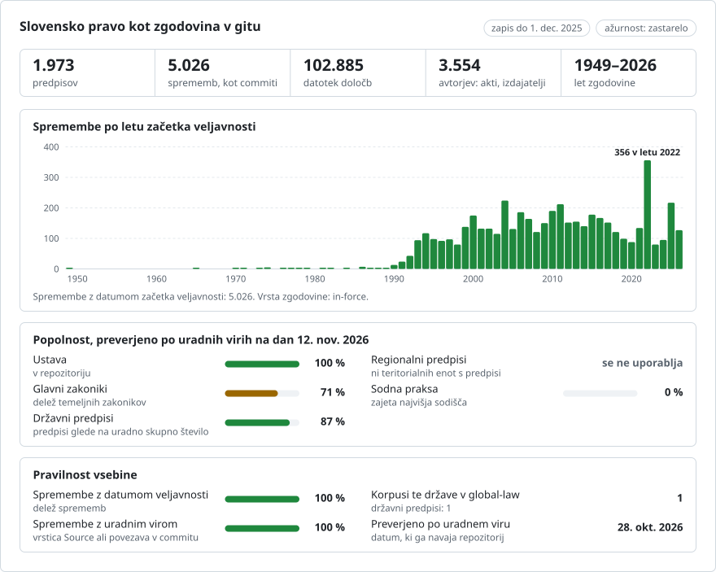

# Slovensko pravo, sprememba za spremembo

**Slovenščina** · [English](README.en.md)

<picture>
<source media="(prefers-color-scheme: dark)" srcset="data/sl/effort-dark.svg">

</picture>

Del repozitorija [lexifina/global-law](https://github.com/lexifina/global-law), enotne zgodovine git za pravo vseh držav: to je slovensko državno pravo, ki ga global-law bere iz `slovenia/national/acts/`.

Dva predpisa Republike Slovenije kot repozitorij git: Ustava Republike Slovenije (URS, Uradni list RS, št. 33/91-I)
in Zakon o volitvah v državni zbor (ZVDZ, Uradni list RS, št. 44/92). Vsak spremembni akt je en commit, pripisan temu
aktu in datiran z dnem, ko je začel veljati, opoldne po ljubljanskem času. Besedilo je besedilo, kot je bilo sprejeto,
in vsako neuradno prečiščeno besedilo (NPB), ki ga je Služba Vlade Republike Slovenije za zakonodajo objavila v
[PIS](https://pisrs.si).

## Vprašanja kot ukazi git

| Vprašanje | Ukaz |
| --- | --- |
| Kaj je 13. julija 1997 določal 68. člen Ustave? | `python tools/na_dan.py 1997-07-13 urs 68` |
| ... in naslednji dan, ko je začel veljati UZS68? | `python tools/na_dan.py 1997-07-14 urs 68` |
| Celotna Ustava, kot je veljala 1. januarja 2000 | `python tools/na_dan.py 2000-01-01 urs` |
| Kateri akt je napisal posamezni odstavek 68. člena? | `git blame urs/clen-068.md` |
| Vse spremembe 68. člena, z aktom in dnevom | `git log --follow --format="%ad %an" --date=short urs/clen-068.md` |
| Enako, z besedilom | `git log -p --word-diff urs/clen-068.md` |
| Vse, kar je spremenil en spremembni akt | `git show akt/2003-01-0899` |
| Kaj se je v ZVDZ spremenilo na en dan | `git show zvdz/2006-08-09 --stat` |
| Commit, ki je veljal ob koncu dneva (UTC) | `git rev-list -1 --before="2004-06-15T23:59:59Z" main -- urs` |
| Vsi spremembni akti z datumi | [`akti.csv`](akti.csv) |
| Spremembe, ki jih ne pojasni noben spremembni akt | `git log --author="PIS RS" --format="%ad %s" --date=short` |
| Spremembe na podlagi odločb Ustavnega sodišča | `git log --author="odl. US" --format="%ad %an %s" --date=short` |

Datoteke členov so `clen-NNN.md` (`clen-003a.md` je 3.a člen). V PowerShellu revizijo s potjo zapišite v narekovajih:
`$r = git rev-list -1 --before="2004-06-15T23:59:59Z" main -- urs; git show "$($r):urs/clen-014.md"`.
Po ponovni izgradnji tega repozitorija obstoječi klon posodobite z `git fetch --force --tags`.

## Datumi in kateri uporabljamo

Slovenski predpis ima dan sprejetja (`Adopted:`), dan, ko ga je objavil Uradni list (`Published:`), in dan začetka
veljavnosti (`In-force:`, velja od). **Commiti so datirani z dnem, ko je sprememba začela veljati**, opoldne po
ljubljanskem času: to je dan, ki odloča, katero besedilo se uporablja. To je dan, ki ga register predpisov v PIS navaja
kot začetek veljavnosti (veljaOd) akta, iz katerega izhaja različica. Kadar se akt začne uporabljati pozneje, kot je
začel veljati, ima commit tudi `Applies-from:`. Vsi datumi so v vsakem sporočilu commita.

Ustavni zakoni začnejo veljati, ko jih Državni zbor razglasi, nekaj dni preden jih natisne Uradni list; ti commiti to
navajajo v vrstici `Date-note:`. Dve odločbi Ustavnega sodišča in uradno prečiščeno besedilo iz leta 2006 v registru
nimajo dneva začetka veljavnosti; datirani so z dnem objave, z vrstico `Date-note:`. Nobena sprememba tu ni starejša od
leta 1970, zato nobenega datuma ni bilo treba prilagoditi.

## Kako je preverjeno

`tools/check_repo.py` vsako različico obeh predpisov prebere iz gita na dan, ko je začela veljati, in jo primerja s PIS:
datoteko za datoteko z besedilom, razčlenjenim iz podatkov PIS, in besedo za besedo z vsemi besedami, ki jih PIS daje za
to različico, prebranimi neodvisno od razčlenjevalnika. `tools/test_repo.py` izvede ukaze iz tega README in preveri
blame, bralnik stanja na dan, vrstni red `git log --follow`, oznake, zaključne vrstice sporočil (trailers) in avtorje.
Rezultati so v [`REPRODUCE.md`](REPRODUCE.md).

## Kaj pomeni »avtor«

Avtor commita je akt, ki je spremembo izvedel: `Uradni list RS, št. 42/97 (UZS68)`, z naslovom, ki se konča z
`@pisrs.invalid` in ne more obstajati, tako da `git blame` navede akt. Register PIS za vsako prečiščeno besedilo navaja
en akt, z začetkom veljavnosti katerega je nastalo. Spremenjeni člen se temu aktu pripiše le, če ga navaja besedilo akta
samo (»se 68. člen spremeni tako, da glasi«), če akt izvede zamenjavo v celotnem besedilu, ki spremembo pojasni
(»v celotnem besedilu zakona se besedilo ... nadomesti«), ali (pri UZ148, katerega besedila PIS nima) če ga navaja
njegov naslov. Končne določbe spremembnega akta, ki jih PIS natisne za aktom, se pripišejo temu aktu.

Spremembo, ki je nič od tega ne pojasni, posebej zapiše `PIS RS (neuradno prečiščeno besedilo)`, z »sprememba
brez pojasnila« v zadevi commita; nikoli ni pripisana aktu. Gre za urejanje, ki ga je opravil PIS sam: prehod z
besedila, kot je bilo natisnjeno v letih 1991 in 1992, v prečiščeno obliko (izpuščena preambula in podpisi, popravljene
tiskovne napake, končne določbe premaknjene za akt) ter v letih 2021 (URS) in 2024 (ZVDZ) odstranitev končnih določb
spremembnih aktov s konca besedila. Committer je vedno `Lexifina`.

Blame pripisuje cele vrstice: pri odstavku, ki sta ga preoblikovala dva akta, navede le poznejšega. Kaj je spremenil
posamezni akt, pokaže `--word-diff`.

## Česa ne prikazuje

- Različic, ki jih PIS ne objavlja: prečiščeno besedilo obstaja le po vsakem spremembnem aktu, zato je sprememba, ki
  jo na isti dan izvedeta dva akta, en korak (pri teh dveh predpisih se to ne zgodi).
- Odločb Ustavnega sodišča, ki določbo razglasijo za neustavno, ne da bi spremenile njeno besedilo; PIS jih zabeleži v
  registru, ne pa v besedilu.
- Opomb PIS, povezav na sodno prakso in pravo EU ter pojasnjevalnega seznama aktov na začetku vsakega prečiščenega
  besedila (akti so namesto tega v commitih).
- Nobenega akta razen teh dveh. Ista izgradnja deluje za vsak akt v PIS: dodajte ga v `ACTS` v `tools/build.py`.

Prečiščena besedila nimajo pravne veljave; verodostojen je samo Uradni list Republike Slovenije.

## Kako je zgrajen

`tools/build.py` bere PIS in ta repozitorij zapiše na novo; isti podatki dajo iste hashe. Vsak korak, programska
oprema, ročno sprejete odločitve in to, kar je naredil model umetne inteligence, so v [`REPRODUCE.md`](REPRODUCE.md).
Mapa vsakega predpisa ima `README.md` s seznamom njegovih določb in podatkom, kako pogosto se je katera spremenila.

## Licenca

Uradna besedila z zakonodajnega področja v Sloveniji niso varovana z avtorsko pravico (2. točka prvega odstavka
9. člena ZASP). Vir: PIS, Pravno-informacijski sistem Republike Slovenije, https://pisrs.si, Služba Vlade Republike
Slovenije za zakonodajo. PIS navaja: »Neuradno prečiščeno besedilo predpisa predstavlja zgolj informativni delovni
pripomoček, glede katerega organ ne jamči odškodninsko ali kako drugače.« Zgodovina, sporočila commitov, tabele in
orodja so objavljeni pod licenco [CC0 1.0](LICENSE).

To je prevod angleške različice ([README.en.md](README.en.md)); če se razlikujeta, velja angleška različica.

## Veljavni zakoni, trenutno besedilo

Poleg obeh predpisov, zapisanih različico za različico, zapis vsebuje 1.971 veljavnih zakonov in ustavnih zakonov iz PIS, vsakega v enem commitu: zakon, ki ga PIS ni nikoli prečistil, v objavljenem besedilu (datiran z dnem začetka veljavnosti in pripisan zakonu samemu), sicer njegovo najnovejše prečiščeno besedilo (datirano z dnem začetka veljavnosti akta, iz katerega je nastalo, zapiše ga PIS in ni pripisano nobenemu aktu). Akti, ki samo spreminjajo druge, so izpuščeni. Starejše različice bodo dodane za njimi, brez prepisovanja zgodovine. Seznam: `data/veljavni-predpisi.csv`.

## Več

Iz repozitorija [lexifina/global-law](https://github.com/lexifina/global-law) (v angleščini):

- [FEATURES.md](https://github.com/lexifina/global-law/blob/main/FEATURES.md): vse funkcije in kaj mora podpirati vsak korpus (`git blame`, `law.py`, orodja MCP)
- [FAQ.md](https://github.com/lexifina/global-law/blob/main/FAQ.md): vprašanja in odgovori · [CONTRIBUTING.md](https://github.com/lexifina/global-law/blob/main/CONTRIBUTING.md): predlaganje sprememb · [MCP.md](https://github.com/lexifina/global-law/blob/main/MCP.md): strežnik MCP · [REPRODUCE.md](https://github.com/lexifina/global-law/blob/main/REPRODUCE.md): kako je nastal · [CHANGELOG.md](https://github.com/lexifina/global-law/blob/main/CHANGELOG.md)
- [FRESHNESS.md](https://github.com/lexifina/global-law/blob/main/FRESHNESS.md): kako ažuren je vsak korpus · [Spremljanje](https://github.com/lexifina/global-law/tree/main/monitoring): ali posodobitve delujejo · [WATCHING.md](https://github.com/lexifina/global-law/blob/main/WATCHING.md): kako se pri vsakem uradnem viru spremljajo spremembe
- [performance/](https://github.com/lexifina/global-law/tree/main/performance): kako hitra so orodja, izmerjeno
- [visualisations/](https://github.com/lexifina/global-law/tree/main/visualisations): grafi in povezave v pravu vsega sveta
- [Ranljivosti](https://github.com/lexifina/global-law/tree/main/vulnerabilities): napake v predpisih, kot so bili objavljeni
