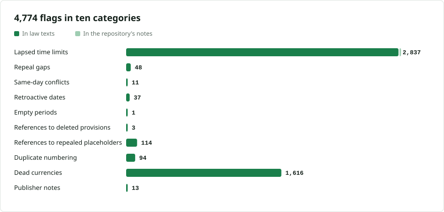

# Vulnerabilities in Slovenian law

[Slovenščina](README.md) · **English**

<picture>
<source media="(prefers-color-scheme: dark)" srcset="img/flags-by-category-dark.svg">

</picture>

The vulnerability detectors from [lexifina/global-law](https://github.com/lexifina/global-law/tree/main/vulnerabilities) look for mechanical mistakes in legislation: a rule applying "until" a date that has passed, a time limit extended only after it had run out, a rule in force before it was published, a reference to an article that no longer exists. global-law's published list (9 November 2026) covered Slovenia with 13 flags (6 repeal gaps and 7 retroactive dates), from an earlier copy of this repository; all 13 are in the Constitution and the Zakon o volitvah v državni zbor, and all are flagged here again. This is a run over this repository only, as it stood at commit [`9d033db`](https://github.com/lexifina/slovenia-law/commit/9d033dbd0be1c957868d995da5f25cbb0e6913d6) on 15 November 2026, with the acts from PIS it now holds.

**In short:** the detectors raised 4,774 flags. A language model reviewed 132 of the strongest, arguing each one for and against; 13 survived. Checked by hand in this repository, none of the 13 is a drafting mistake: 6 are official consolidated texts (UPB), which this repository dates by the day the last amendment they consolidate took effect, so each looks in force before it was published; 4 are repeal gaps where the article's text was held in another file for a time; 2 are transitional deadlines of amending acts that have run their course; and 1 is a constitutional act that took effect on its proclamation, as it says. Two flags the model set aside are open on reading the text: the Zakon o spremembah Zakona o tajnih podatkih (ZTP-C), adopted on 28 January 2010 and published on 9 February 2010, says "Ta zakon začne veljati 1. januarja 2010."; and the 2001 amendment that moved the census from April 2001 to April 2002 took effect on 27 April 2001, twelve days after the census period it moved had ended. The 114 references to repealed placeholders, read by hand, include 25 references, in provisions that still apply (penalty provisions among them), to an article now "(črtan)" or "(prenehal veljati)"; the rest are spent or transitional, are in an act most of which no longer applies, or were misread. Later, this will be formalised in Lean, similar to our work on [the US tax code](https://lexifina.com/blog/formalizing-the-us-tax-code) and [US case law](https://lexifina.com/blog/formalizing-all-us-case-law-in-lean).

A flag is a prompt to look, not legal advice, and nothing here has been tested in court.

## Flags by category

| Category | What it looks for | Flags | In law texts | Reviewed | Survived review |
| --- | --- | ---: | ---: | ---: | ---: |
| Lapsed time limits | Text still applying a rule "until" a date that has passed | 2,837 | 2,836 | 40 | 2 |
| Repeal gaps | A provision left without text for a time and then restored | 48 | 48 | 40 | 4 |
| Same-day conflicts | Two acts changing the same provision with effect on the same day | 11 | 11 | 11 | 0 |
| Retroactive or pre-publication dates | A rule in force before it was published | 37 | 37 | 37 | 7 |
| Empty periods | A time limit extended by an act that took effect after it had run out | 1 | 1 | 1 | 0 |
| References to deleted provisions | A provision citing an article that no longer exists | 3 | 3 | 3 | 0 |
| References to repealed placeholders | A provision citing an article whose text is only "(črtan)", "(prenehal veljati)" or "(razveljavljen)" | 114 | 114 | 0 | 0 |
| Duplicate numbering | Two units with the same number in one act | 94 | 94 | 0 | 0 |
| Dead currencies | Amounts in currencies no longer in use | 1,616 | 1,616 | 0 | 0 |
| Publisher notes | Notes that an amendment could not be carried out | 13 | 13 | 0 | 0 |

"In law texts" counts the Constitution, the acts and the decrees under `ustava/`, `zakon/` and `uredba/`, including the treaties that ratification acts print after their signature (`pravilnik/` and `sklep/` hold only an index). The one other flag is in this repository's own README, on the date the act folders were renamed. The searches for stale amounts and dead fines found nothing to flag. The search for references to repealed placeholders now reads the way PIS marks an article that is gone, "(črtan)" and "(prenehal veljati)" in brackets, beside "(razveljavljen)", which it read before.

*Edge cases: the 13 flags that survived the review, grouped by what they turned out to be, the two open flags, the 114 references to repealed placeholders, and what the other flags are, in [EDGE-CASES.en.md](EDGE-CASES.en.md).*

## Problems found in this repository

- **Articles without a file of their own.** The build starts a new file at a line "# N. člen". 364 articles lettered č, š or ž in 220 acts have no such line and sit in the file of the article lettered c, s or z: [zakon/2001/zako1265/clen-052c.md](https://github.com/lexifina/slovenia-law/blob/9d033dbd0be1c957868d995da5f25cbb0e6913d6/zakon/2001/zako1265/clen-052c.md) holds Articles 52.c and 52.č of the Zakon o brezplačni pravni pomoči. 502 headings in 91 acts are written with no space before the bracket ("31. člen(črtan)"), 486 of them for articles that are gone, and sit at the end of the file of the article before: [zakon/1999/zako1884/clen-030.md](https://github.com/lexifina/slovenia-law/blob/9d033dbd0be1c957868d995da5f25cbb0e6913d6/zakon/1999/zako1884/clen-030.md) ends with "31. člen(črtan)". Such articles have no history of their own, and the three "references to deleted provisions" are these headings.
- **Articles missing from the history for years.** The same happened to articles that an amendment replaced: Article 22 of the Zakon o detektivski dejavnosti, which Article 13 of ZDD-A (Uradni list RS, št. 96/02) replaced ("se spremenita tako, da se glasita"), sat at the end of Article 21's file from 29 November 2002 until ZDD-D (Uradni list RS, št. 29/10) on 24 April 2010 ([removed](https://github.com/lexifina/slovenia-law/commit/71af33ab020ff6a9ac25913e51146788d16bf011), [back](https://github.com/lexifina/slovenia-law/commit/9728e9536290b25eced0eed745687cf82aef43ea)); Article 7 of the Zakon o preprečevanju dela in zaposlovanja na črno, replaced by ZPDZC-A, sat in Article 6's file from 2 December 2006 to 12 April 2013 ([removed](https://github.com/lexifina/slovenia-law/commit/213c5a16ece8bb0c5c3618906f971f026f810b4d), [back](https://github.com/lexifina/slovenia-law/commit/bbc465695b39d8a84396ce8f25c3d7081fd8f037)). For those years `git log` and `git blame` show the article as deleted.

## Files

| File | What it holds |
| --- | --- |
| [data/flags.csv](data/flags.csv) | Every flag, one row per provision and issue |
| [data/reviewed.csv](data/reviewed.csv) | The 132 flags the model reviewed, with its verdict and reason |
| [data/by_category.csv](data/by_category.csv) | The counts in the table above |
| [tools/](tools/) | The scripts that made this run |

Columns: `category` and `category_sl` (the category in English and Slovenian), `detector`, `kind` (`law` or `other`), `path` (the file in this repository), `date` (the date the flag turns on), `reference` (the act or line involved), `summary`, `score` (the detector's ranking, 0 to 1), `review` (`artefact`, `lawful` or `candidate_defect`), `survives_rebuttal`, `review_note` (the model's reason, in English), `url` (the provision at the commit that was read, or, for one removed since, at the last commit that held it; for retroactive dates, the commit that added the act).

## How it was made

- **Detectors:** global-law's [vulnerabilities/scripts](https://github.com/lexifina/global-law/tree/main/vulnerabilities/scripts), run on this repository at commit `9d033db`. global-law replays this repository only up to an earlier commit, so the history table the detectors read was built from this repository's own commits (the author, that is the act that made each change, and the `Law`, `In-force` and `Kind` trailers), counting as law changes the kinds `law`, `Zakon`, `Uredba`, `decree`, `publisher` (versions from PIS's consolidated texts) and `court` (the Constitutional Court's decisions that changed a text): 5,027 rows. The paths of the history were mapped to each act's folder since the move of 10 November 2026 (`data/paths.json`).
- **Fixes for Slovenian:** before the review the detectors were taught that PIS marks an article that is gone "(črtan)" or "(prenehal veljati)", and that an article where only some paragraphs are "(črtan)" is not gone; that "drugi odstavek 3. člena" cites Article 3 (the word "odstavek" had been taken for a Turkish series marker); that "463.a člena" is Article 463.a and "18.o člen" Article 18.o, not 18; that "14. členu Zakona o delovnih razmerjih" names another act; and that "4. člani" (members) is not an article. Slovenian months in the genitive ("1. januarja 2020") and "do" were already read.
- **Model review:** gpt-5.4-mini, the 40 strongest flags per category (all of them where a category has fewer), and for lapsed time limits also the 40 strongest in law texts, which were the same 40; one pass says whether a flag is real, a second argues that it is not. Empty periods use global-law's own review for that category, followed by the same second pass. global-law's own list used a different model.
- **Hand check:** every case that survived was read in this repository's history and texts, with the amending act where this repository holds it; so were the two open flags, the three references to deleted provisions and the 114 references to repealed placeholders. Most acts are held here only in their current text, so for those the history cannot show which amendment deleted a cited article.

To report a correction, open an issue with the provision and an official source.

## Licence

The lists and notes are Lexifina's and, like the rest of this repository's own contributions (see [LICENSE](../LICENSE)), are dedicated to the public domain under CC0 1.0. Quoted law text is as PIS publishes it; official texts in the legislative, administrative and judicial field are not protected by copyright in Slovenia (Article 9 ZASP).
