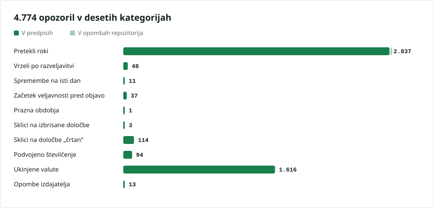

# Ranljivosti v slovenskih predpisih

**Slovenščina** · [English](README.en.md)

<picture>
<source media="(prefers-color-scheme: dark)" srcset="img/flags-by-category-dark.sl.svg">

</picture>

Detektorji ranljivosti iz repozitorija [lexifina/global-law](https://github.com/lexifina/global-law/tree/main/vulnerabilities) iščejo mehanske napake v predpisih: pravilo, ki se še vedno uporablja „do“ datuma, ki je že minil, rok, ki je bil podaljšan šele po izteku, predpis, ki je začel veljati, preden je bil objavljen, sklic na člen, ki ga ni več. Seznam, ki ga je global-law objavil 9. novembra 2026, je Slovenijo zajel s 13 opozorili (6 vrzeli po razveljavitvi in 7 primerov začetka veljavnosti pred objavo), in sicer po starejši kopiji tega repozitorija; vseh 13 je v Ustavi in Zakonu o volitvah v državni zbor in vsa so tudi tu ponovno označena. To je pregled samo tega repozitorija, v stanju commita [`9d033db`](https://github.com/lexifina/slovenia-law/commit/9d033dbd0be1c957868d995da5f25cbb0e6913d6) z dne 15. novembra 2026, s predpisi iz PIS, ki jih zdaj vsebuje.

**Na kratko:** detektorji so sprožili 4.774 opozoril. Jezikovni model je pregledal 132 najmočnejših in o vsakem navedel razloge za in proti; 13 jih je pregled prestalo. Po ročni preverbi v tem repozitoriju nobeno od teh 13 ni napaka pri pripravi predpisa: 6 je uradnih prečiščenih besedil (UPB), ki jih ta repozitorij datira z dnem, ko je začela veljati zadnja sprememba, ki jo prečiščujejo, zato je videti, kot da veljajo pred objavo; 4 so vrzeli po razveljavitvi, pri katerih je bilo besedilo člena nekaj časa v drugi datoteki; 2 sta prehodna roka novel, ki sta se iztekla; 1 je ustavni zakon, ki je začel veljati z razglasitvijo, kot sam določa. Dve opozorili, ki ju je model zavrnil, ostajata po branju besedila odprti: Zakon o spremembah Zakona o tajnih podatkih (ZTP-C), sprejet 28. januarja 2010 in objavljen 9. februarja 2010, določa „Ta zakon začne veljati 1. januarja 2010.“; novela, ki je popis prebivalstva prestavila z aprila 2001 na april 2002, pa je začela veljati 27. aprila 2001, dvanajst dni po izteku obdobja popisa, ki ga je prestavila. Med 114 sklici na določbe „črtan“, ročno prebranimi, je 25 sklicev v določbah, ki še veljajo (med njimi kazenskih), na člen, ki se zdaj glasi „(črtan)“ ali „(prenehal veljati)“; ostali so izčrpani ali prehodni, so v zakonu, ki večinoma ne velja več, ali pa jih je detektor napačno prebral. Pozneje bo to formalizirano v jeziku Lean, podobno kot naše delo na [davčnem zakoniku ZDA](https://lexifina.com/blog/formalizing-the-us-tax-code) in [sodni praksi ZDA](https://lexifina.com/blog/formalizing-all-us-case-law-in-lean).

Opozorilo je poziv, da se nekaj pogleda, ni pravni nasvet, in nič od tega ni bilo preizkušeno pred sodiščem.

## Opozorila po kategorijah

| Kategorija | Kaj išče | Opozorila | V predpisih | Pregledano | Prestalo pregled |
| --- | --- | ---: | ---: | ---: | ---: |
| Pretekli roki | Besedilo, ki pravilo še vedno uporablja „do“ datuma, ki je že minil | 2.837 | 2.836 | 40 | 2 |
| Vrzeli po razveljavitvi | Določba, ki je bila nekaj časa brez besedila in nato obnovljena | 48 | 48 | 40 | 4 |
| Spremembe na isti dan | Predpisa, ki isto določbo spremenita z učinkom na isti dan | 11 | 11 | 11 | 0 |
| Začetek veljavnosti pred objavo | Predpis, ki velja, preden je objavljen | 37 | 37 | 37 | 7 |
| Prazna obdobja | Rok, podaljšan s predpisom, ki je začel veljati po izteku roka | 1 | 1 | 1 | 0 |
| Sklici na izbrisane določbe | Določba, ki se sklicuje na člen, ki ga ni več | 3 | 3 | 3 | 0 |
| Sklici na določbe „črtan“ | Določba, ki se sklicuje na člen, katerega besedilo je le „(črtan)“, „(prenehal veljati)“ ali „(razveljavljen)“ | 114 | 114 | 0 | 0 |
| Podvojeno številčenje | Dve enoti z isto številko v istem predpisu | 94 | 94 | 0 | 0 |
| Ukinjene valute | Zneski v valutah, ki niso več v uporabi | 1.616 | 1.616 | 0 | 0 |
| Opombe izdajatelja | Opombe, da sprememba ni mogla biti vnesena | 13 | 13 | 0 | 0 |

„V predpisih“ zajema Ustavo ter zakone in uredbe v `ustava/`, `zakon/` in `uredba/`, vključno z mednarodnimi pogodbami, ki jih zakoni o ratifikaciji natisnejo za podpisom (`pravilnik/` in `sklep/` vsebujeta le kazalo). Edino drugo opozorilo je v README tega repozitorija, pri datumu, ko so bile mape predpisov preimenovane. Iskanje zastarelih zneskov in glob brez opisa prekrška ni našlo ničesar. Iskanje sklicev na določbe „črtan“ zdaj prebere, kako PIS označi člen, ki ga ni več, „(črtan)“ in „(prenehal veljati)“ v oklepaju, poleg „(razveljavljen)“, ki ga je bralo že prej.

*Mejni primeri: 13 opozoril, ki so prestala pregled, razvrščenih po tem, kaj so se izkazala, dve odprti opozorili, 114 sklicev na določbe „črtan“ in kaj so ostala opozorila, v [EDGE-CASES.md](EDGE-CASES.md).*

## Težave, najdene v tem repozitoriju

- **Členi brez lastne datoteke.** Izgradnja začne novo datoteko pri vrstici „# N. člen“. 364 členov, označenih s črko č, š ali ž, v 220 predpisih take vrstice nima in je v datoteki člena, označenega s c, s ali z: [zakon/2001/zako1265/clen-052c.md](https://github.com/lexifina/slovenia-law/blob/9d033dbd0be1c957868d995da5f25cbb0e6913d6/zakon/2001/zako1265/clen-052c.md) vsebuje 52.c in 52.č člen Zakona o brezplačni pravni pomoči. 502 naslova v 91 predpisih sta zapisana brez presledka pred oklepajem („31. člen(črtan)“), 486 od njih za člene, ki jih ni več, in sta na koncu datoteke prejšnjega člena: [zakon/1999/zako1884/clen-030.md](https://github.com/lexifina/slovenia-law/blob/9d033dbd0be1c957868d995da5f25cbb0e6913d6/zakon/1999/zako1884/clen-030.md) se konča z „31. člen(črtan)“. Taki členi nimajo lastne zgodovine, trije „sklici na izbrisane določbe“ pa so prav ti naslovi.
- **Členi, ki v zgodovini leta manjkajo.** Enako se je zgodilo členom, ki jih je novela nadomestila: 22. člen Zakona o detektivski dejavnosti, ki ga je nadomestil 13. člen ZDD-A (Uradni list RS, št. 96/02) („se spremenita tako, da se glasita“), je bil od 29. novembra 2002 do ZDD-D (Uradni list RS, št. 29/10) 24. aprila 2010 na koncu datoteke 21. člena ([odstranjen](https://github.com/lexifina/slovenia-law/commit/71af33ab020ff6a9ac25913e51146788d16bf011), [vrnjen](https://github.com/lexifina/slovenia-law/commit/9728e9536290b25eced0eed745687cf82aef43ea)); 7. člen Zakona o preprečevanju dela in zaposlovanja na črno, ki ga je nadomestil ZPDZC-A, je bil od 2. decembra 2006 do 12. aprila 2013 v datoteki 6. člena ([odstranjen](https://github.com/lexifina/slovenia-law/commit/213c5a16ece8bb0c5c3618906f971f026f810b4d), [vrnjen](https://github.com/lexifina/slovenia-law/commit/bbc465695b39d8a84396ce8f25c3d7081fd8f037)). Za ta leta `git log` in `git blame` kažeta člen kot izbrisan.

## Datoteke

| Datoteka | Kaj vsebuje |
| --- | --- |
| [data/flags.csv](data/flags.csv) | Vsa opozorila, ena vrstica za vsako določbo in težavo |
| [data/reviewed.csv](data/reviewed.csv) | 132 opozoril, ki jih je pregledal model, z oceno in utemeljitvijo |
| [data/by_category.csv](data/by_category.csv) | Števila iz zgornje tabele |
| [tools/](tools/) | Skripte, s katerimi je bil pregled opravljen |

Stolpci: `category` in `category_sl` (kategorija v angleščini in slovenščini), `detector`, `kind` (`law` za predpis ali `other`), `path` (datoteka v tem repozitoriju), `date` (datum, na katerega se opozorilo nanaša), `reference` (predpis ali vrstica, za katero gre), `summary`, `score` (razvrstitev detektorja, od 0 do 1), `review` (`artefact` za napako v podatkih, `lawful` za zakonito ali `candidate_defect` za možno napako), `survives_rebuttal`, `review_note` (utemeljitev modela, v angleščini), `url` (določba v prebranem commitu ali, za določbo, ki je bila medtem odstranjena, v zadnjem commitu, ki jo je še vseboval; pri začetku veljavnosti pred objavo commit, s katerim je bil predpis dodan).

## Kako je bil pregled opravljen

- **Detektorji:** [vulnerabilities/scripts](https://github.com/lexifina/global-law/tree/main/vulnerabilities/scripts) iz repozitorija global-law, zagnani na tem repozitoriju v commitu `9d033db`. global-law ta repozitorij ponovi le do starejšega commita, zato je bila tabela zgodovine, ki jo berejo detektorji, zgrajena iz lastnih commitov tega repozitorija (avtor, torej predpis, ki je spremembo uvedel, in trailerji `Law`, `In-force` in `Kind`); kot spremembe predpisov štejejo vrste `law`, `Zakon`, `Uredba`, `decree`, `publisher` (različice iz prečiščenih besedil PIS) in `court` (odločbe Ustavnega sodišča, ki so spremenile besedilo): 5.027 vrstic. Poti v zgodovini so bile povezane z mapo vsakega predpisa po premiku 10. novembra 2026 (`data/paths.json`).
- **Popravki za slovenščino:** pred pregledom so se detektorji naučili, da PIS člen, ki ga ni več, označi s „(črtan)“ ali „(prenehal veljati)“ in da člen, pri katerem so črtani le nekateri odstavki, ni izbrisan; da se „drugi odstavek 3. člena“ sklicuje na 3. člen (besedo „odstavek“ so prej imeli za turško oznako posebne vrste členov); da je „463.a člena“ 463.a člen in „18.o člen“ 18.o člen, ne 18.; da „14. členu Zakona o delovnih razmerjih“ imenuje drug zakon; in da „4. člani“ ni člen. Slovenske mesece v rodilniku („1. januarja 2020“) in „do“ so brali že prej.
- **Pregled z modelom:** gpt-5.4-mini, 40 najmočnejših opozoril v vsaki kategoriji (vsa, kjer jih je manj), pri preteklih rokih pa še 40 najmočnejših v predpisih, ki so bila ista; en prehod oceni, ali je opozorilo resnično, drugi navede razloge, da ni. Pri praznih obdobjih je uporabljen lastni pregled global-lawa za to kategorijo, ki mu sledi isti drugi prehod. Lastni seznam global-lawa je bil izdelan z drugim modelom.
- **Ročna preverba:** vsak primer, ki je prestal pregled, je bil prebran v zgodovini in besedilih tega repozitorija, skupaj z besedilom novele, kadar ga repozitorij vsebuje; prav tako obe odprti opozorili, trije sklici na izbrisane določbe in 114 sklicev na določbe „črtan“. Večina predpisov je tu le v trenutnem besedilu, zato zgodovina pri njih ne pokaže, katera novela je izbrisala člen, na katerega se sklicujejo.

Za popravek odprite issue z navedbo določbe in uradnega vira.

## Licenca

Seznami in opombe so delo Lexifine in so, kot preostali lastni prispevki tega repozitorija (glejte [LICENSE](../LICENSE)), dani v javno domeno pod licenco CC0 1.0. Navedeno besedilo predpisov je takšno, kot ga objavlja PIS; uradna besedila z zakonodajnega, upravnega in sodnega področja v Sloveniji niso varovana z avtorsko pravico (9. člen ZASP).
